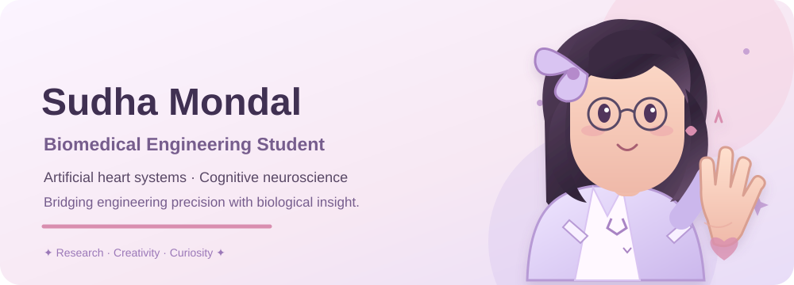
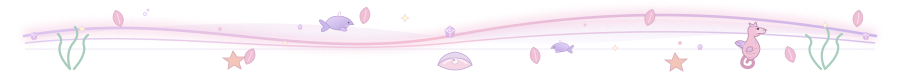

## 👋 Hi, I'm Sudha Mondal | Engineering Hearts, Decoding Minds 🌸
**B.Tech Biomedical Engineering student, Adamas University** — driven by two questions: *can we rebuild the human heart, and can we understand the human mind?* An aspiring MedTech innovator bridging technical rigor with human-centered design — researcher, writer, photographer, and classical dancer in the margins.

## 🎯 Research Interests
- 🫀 **Total Artificial Heart (TAH) Systems** — mechanical circulatory support, cardiac biomechanics, and artificial organ engineering.
- 🧠 **Cognitive Neuroscience** — the neural architecture of cognition, neural engineering, and brain-centered MedTech.
- 🧬 Biomaterials, biosensors & regenerative medicine
- 🔗 Interdisciplinary synthesis of engineering methodology and biological application

## 🔭 What I'm Currently Working On
- **Biomechanics & Modeling:** Soft and hard tissue biomechanics, computational modeling, and fluid-structure interaction in prosthetic heart valves — groundwork that feeds directly into my long-term interest in Total Artificial Heart design.
- **Paper Microfluidics:** Portable, low-cost paper microfluidic platforms for rapid food quality screening and multiplexed detection without expensive lab infrastructure.

## 🌱 What I'm Exploring & Learning
- Secure, compliant AI/ML-driven software development and conversational AI governance.
- CI/CD fundamentals with Jenkins.
- Advanced numerical simulations and symbolic programming using MATLAB (`laplace`, `ilaplace`) and C programming.
- Digital electronics prototyping (logic gates, adders, multiplexers, decoders).

## 🎓 Education

**B.Tech in Biomedical Engineering** — *Adamas University, Kolkata, India* (2025 – 2029, Expected)
School of Engineering & Technology · Residential Student

**Higher Secondary Certificate (HSC), Science** — *Milestone College, Dhaka, Bangladesh* (2024)
GPA: 4.92 / 5.00

**Secondary School Certificate (SSC), Science** — *Mohammadpur Preparatory School & College, Dhaka* (2022)
GPA: 5.00 / 5.00

## 💼 Experience

**Student Intern** — BD TRADE INFO / Infintex BD TRADE · Dhaka, Bangladesh (Hybrid) · *Jun 2026 – Jul 2026*
- Supported cross-functional tasks for the core team, demonstrating professionalism and adaptability in a hybrid work environment.

**HR Volunteer** — BASTOB, Initiative for People's Self-Development · Dhaka, Bangladesh · *Jan 2025 – Mar 2025*
- Collaborated with the HR team on organizational development and institutional policy initiatives (Gender Policy & Safeguarding Policy).
- Advocated for third-gender-inclusive documentation practices in formal institutional processes.
- Led fieldwork, team coordination, and event photography for community-focused programs.

**Journalist Intern** — Somoy TV (Somoy Media Limited) · Dhaka, Bangladesh · *Sep 2024 – Dec 2024*
- Verified information and edited news copy for accuracy, clarity, and journalistic quality in time-sensitive newsroom workflows.
- Published an independent byline column: *"Planning to study in US after HSC? Here's what you should know."*

## 📜 Certifications

- **Enterprise Design Thinking Practitioner** — IBM *(Jan 2026)*
- **LFS167: Introduction to Jenkins** — The Linux Foundation *(Jan 2026)*
- **LFS120: Conversational AI – Ensuring Compliance and Mitigating Risks** — The Linux Foundation *(Jan 2026)*
- **LFEL1012: Secure AI/ML-Driven Software Development** — The Linux Foundation *(Dec 2025)*

## 🛠️ Tech Stack & Lab Methodologies
- **Programming & Tools:** C, MATLAB, Git & GitHub, Jenkins (CI/CD fundamentals).
- **Engineering Labs:** Circuit prototyping, clinical laboratory methodologies (slide agglutination blood typing, bleeding time assays), and control systems.
- **Documentation:** LaTeX & structured scientific reporting (Aim, Principle, Requirements, Observation, Discussion framework).

## 📊 GitHub Stats

### 📰 Recent GitHub Activity
<!--START_SECTION:activity-->
<!--END_SECTION:activity-->

## 🗣️ Languages
- 🇧🇩 **Bengali** — Native / Bilingual proficiency
- 🇬🇧 **English** — Professional working proficiency (IELTS 6.5)
- 🇫🇷 **French** — Elementary proficiency
- 🇷🇺 **Russian** — Elementary proficiency

## 🎨 Beyond the Lab
When I'm not in the lab or buried in MATLAB simulations, I'm usually playing the violin, dancing Bharatanatyam, mixing colors in abstract acrylic paintings, writing atmospheric short fiction and poetry, designing progressive literary quiz tournaments, nature journaling, or training in Taekwondo (Yellow Belt) and rifle shooting sports. 🎻 🩰 🎨 ✍️ 🎯

## 🧭 Roadmap
- [x] Begin B.Tech in Biomedical Engineering at Adamas University
- [x] Complete IBM Enterprise Design Thinking Practitioner certification
- [x] Complete Linux Foundation certifications in Jenkins, Conversational AI compliance, and Secure AI/ML development
- [ ] Go deeper into Total Artificial Heart (TAH) design and mechanical circulatory support
- [ ] Study Cognitive Neuroscience & neural engineering in more depth
- [ ] Publish my first open-source biomedical engineering project
- [ ] Present research at an undergraduate symposium

## 📫 How to Reach Me

## 😄 Pronouns
She/Her

> *"From artificial hearts to the architecture of thought - engineering tomorrow's MedTech."*

⭐ **If any of this resonates with you - research, MedTech, or just the saree-wearing mascot above - say hi!**

